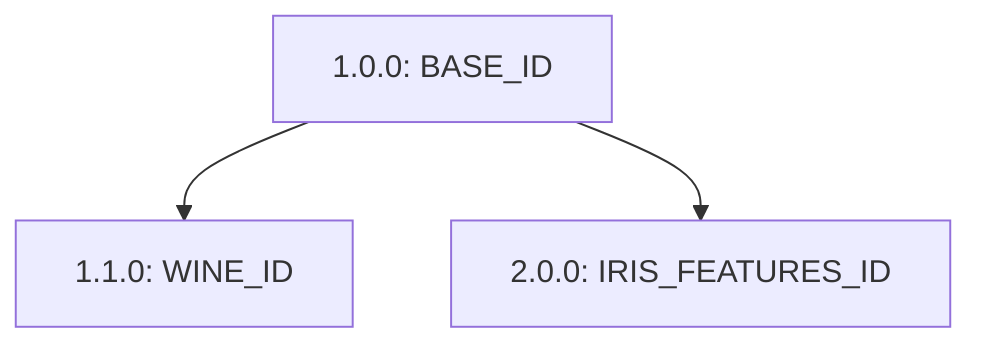

# Практическая работа № 3: версионирование данных

Автор: Zagudaev.

Статус: работа не завершена; отсутствующие результаты ниже явно отмечены. Этот отчёт пока нельзя сдавать как завершённый.

## Окружение и подготовка данных

Требуется Python 3.12; целевые версии: DVC 3.63.0, ClearML 2.0.2, scikit-learn 1.7.2, pandas 2.3.3. Выполнение DVC ещё не зафиксировано.

Источник: встроенные `load_iris(as_frame=True)` (150 строк) и `load_wine(as_frame=True)` (178 строк). Строки стабильно сортируются по всем исходным признакам и target; порядок исходных столбцов сохранён. CSV: UTF-8 без BOM, LF, без индекса, `float_format="%.15g"`. Площади добавляются после сортировки: `sepal_area = sepal length (cm) * sepal width (cm)`, аналогично `petal_area`.

Каждый режим генератора записывает только соответствующий CSV: `base` — Iris, `wine` — Wine, `iris_features` — Iris с площадями. Для отдельного состояния используется пустая папка или DVC checkout; генератор не удаляет соседние файлы. Проверка требует точного состава выбранного состояния.

`check_data.py` проверяет набор файлов, порядок столбцов и строк, исходные значения и target, типы, пропуски, конечность чисел и обе площади. Дополнительно выводит SHA-256, форму, столбцы, типы и контрольные строки.

## DVC: версии, ветвление и слияние

Не выполнено: история Git, версии DVC, remote и чистое восстановление ещё не подтверждены.

## ClearML Dataset

Project: `MIIT/MLOps/practice_3/zagudaev`. Dataset name: `sklearn-tabular-zagudaev`.

Созданы три отдельные версии. Файлы загружены через `upload()` до `finalize()`; все статусы — Completed. Исходная версия имеет тег `base`. В Wine добавлен только новый файл; неизменённый Iris унаследован от базы, что дополнительно проверено по `file_owner_dataset_ids`.

| Обозначение | Version | Dataset ID | Parent IDs | Added | Modified | Removed |
|---|---|---|---|---|---|---|
| `BASE_ID` | 1.0.0 | `0c3ab7bf5e7b46e9b448249dd5a71103` |  | iris.csv |  |  |
| `WINE_ID` | 1.1.0 | `73fd53584c064ba0a45c3187f3e7af98` | 0c3ab7bf5e7b46e9b448249dd5a71103 | wine.csv |  |  |
| `IRIS_FEATURES_ID` | 2.0.0 | `ad76a5e5fb044c71af432a1c612207e2` | 0c3ab7bf5e7b46e9b448249dd5a71103 |  | iris.csv |  |

Dependency graph, полученный из SDK:

```json
{
  "0c3ab7bf5e7b46e9b448249dd5a71103": [],
  "73fd53584c064ba0a45c3187f3e7af98": [
    "0c3ab7bf5e7b46e9b448249dd5a71103"
  ],
  "ad76a5e5fb044c71af432a1c612207e2": [
    "0c3ab7bf5e7b46e9b448249dd5a71103"
  ]
}
```



Все версии повторно получены строго по ID в отдельном процессе с новым пустым ClearML cache и скачаны в три разные пустые директории через `get_mutable_local_copy(overwrite=False)`. Это проверка скачивания из storage на этом компьютере с чистым cache; отдельная физическая машина не использовалась. Состав и SHA-256 всех трёх версий совпали с соответствующими DVC-состояниями.

### Скачанная версия 1.0.0 — `BASE_ID`

| Файл | Строки × столбцы | Пропуски | SHA-256 |
|---|---:|---:|---|
| `data/iris.csv` | 150 × 5 | 0 | `6d700503c9c2e2c71d187b889a87af8a8d3a6dd5bae1266d46f4ee4db5a6349f` |

Столбцы `data/iris.csv`: `sepal length (cm)`, `sepal width (cm)`, `petal length (cm)`, `petal width (cm)`, `target`.
Типы: `sepal length (cm): float64`, `sepal width (cm): float64`, `petal length (cm): float64`, `petal width (cm): float64`, `target: int64`.

[Метаданные в ClearML UI](https://app.clear.ml/projects/2decfa37e9e34832bed1134763d925dd/experiments/0c3ab7bf5e7b46e9b448249dd5a71103/output/log).

### Скачанная версия 1.1.0 — `WINE_ID`

| Файл | Строки × столбцы | Пропуски | SHA-256 |
|---|---:|---:|---|
| `data/iris.csv` | 150 × 5 | 0 | `6d700503c9c2e2c71d187b889a87af8a8d3a6dd5bae1266d46f4ee4db5a6349f` |
| `data/wine.csv` | 178 × 14 | 0 | `38860ba04ace4d402242340bcf40be4bd6f4ebde9144a3dc89dc12c20f7f8e60` |

Столбцы `data/iris.csv`: `sepal length (cm)`, `sepal width (cm)`, `petal length (cm)`, `petal width (cm)`, `target`.
Типы: `sepal length (cm): float64`, `sepal width (cm): float64`, `petal length (cm): float64`, `petal width (cm): float64`, `target: int64`.

Столбцы `data/wine.csv`: `alcohol`, `malic_acid`, `ash`, `alcalinity_of_ash`, `magnesium`, `total_phenols`, `flavanoids`, `nonflavanoid_phenols`, `proanthocyanins`, `color_intensity`, `hue`, `od280/od315_of_diluted_wines`, `proline`, `target`.
Типы: `alcohol: float64`, `malic_acid: float64`, `ash: float64`, `alcalinity_of_ash: float64`, `magnesium: int64`, `total_phenols: float64`, `flavanoids: float64`, `nonflavanoid_phenols: float64`, `proanthocyanins: float64`, `color_intensity: float64`, `hue: float64`, `od280/od315_of_diluted_wines: float64`, `proline: int64`, `target: int64`.

[Метаданные в ClearML UI](https://app.clear.ml/projects/2decfa37e9e34832bed1134763d925dd/experiments/73fd53584c064ba0a45c3187f3e7af98/output/log).

### Скачанная версия 2.0.0 — `IRIS_FEATURES_ID`

| Файл | Строки × столбцы | Пропуски | SHA-256 |
|---|---:|---:|---|
| `data/iris.csv` | 150 × 7 | 0 | `3e1ba63f55da2aabc432d00b1670140f5162bf9ef34b837598ec2fc176c9ff26` |

Столбцы `data/iris.csv`: `sepal length (cm)`, `sepal width (cm)`, `petal length (cm)`, `petal width (cm)`, `target`, `sepal_area`, `petal_area`.
Типы: `sepal length (cm): float64`, `sepal width (cm): float64`, `petal length (cm): float64`, `petal width (cm): float64`, `target: int64`, `sepal_area: float64`, `petal_area: float64`.

[Метаданные в ClearML UI](https://app.clear.ml/projects/2decfa37e9e34832bed1134763d925dd/experiments/ad76a5e5fb044c71af432a1c612207e2/output/log).

## Сравнение по наблюдениям

Таблица наблюдений будет сформирована после реального выполнения обоих инструментов; неподтверждённые результаты не подставляются.

## Ответы на вопросы

1. **Идентификация DVC.** Конкретный Git commit фиксирует `data.dvc`, а его content hash определяет точное содержимое данных. Сами объекты должны сохраняться в cache/remote; вместе commit, метаданные и доступное содержимое обеспечивают восстановление.

2. **Почему Git недостаточно.** В Git находятся код и указатели; CSV туда не добавлялись. Без remote и при утрате локального cache новый clone не получит содержимое по одним хэшам.

3. **Version и ID.** Version — человекочитаемая метка, например 1.0.0; Dataset ID — однозначный идентификатор конкретного объекта сервера. В коде скачивания используется точный ID, а не поиск только по имени/версии.

4. **finalize.** Он переводит текущий mutable Dataset в immutable Completed. Новый объект и новый ID создаёт отдельный `Dataset.create`, которому передают parent ID и новый version.

5. **Доказательство происхождения 2.0.0.** В dependency graph значение для IRIS_FEATURES_ID должно быть ровно `[BASE_ID]`; WINE_ID не должен встречаться среди предков. Дополнительная проверка состава: только изменённый Iris, без Wine.

6. **git switch без checkout.** Меняются метаданные Git, но CSV могут остаться от предыдущей ветки. Тогда фактический workspace не соответствует data.dvc; dvc status показывает расхождение. Нужен checkout либо pull при отсутствии cache.

7. **Удобство.** DVC удобен для совместного изменения данных вместе с кодом в Git-ветках: в этой работе объединяются добавление Wine и признаки Iris. ClearML Dataset удобен для независимого выбора набора по ID и просмотра происхождения версий через сервер: две ветви lineage доступны одновременно без git switch.

## Демонстрационный ноутбук и проверки

Демонстрационный notebook ещё не выполнен полностью.

Проверки генератора: повторяемость байтов всех режимов, отсутствие изменений соседнего CSV, отдельное состояние iris_features; отклонение отсутствующего файла, индекса, потери строки, неверной площади, target, пропуска, нарушения сортировки, лишнего столбца и бесконечного значения. Команда: `python -m unittest -v test_data`.

Машиночитаемые доказательства: `evidence/dvc.json`, `evidence/clearml_ids.json`, `evidence/clearml.json`, `evidence/demo.json`. В отчёт и Git не включаются credentials, полный clearml.conf, рабочие CSV, cache и remote.

## Официальные источники

- [DVC: разрешение конфликтов метаданных](https://dvc.org/doc/user-guide/how-to/resolve-merge-conflicts)
- [ClearML Dataset API](https://clear.ml/docs/latest/docs/references/sdk/dataset/)
- [ClearML: настройка SDK](https://clear.ml/docs/latest/docs/clearml_sdk/clearml_sdk_setup/)
- [ClearML: отдельный cache через переменные окружения](https://www.clear.ml/docs/latest/docs/configs/env_vars/)
